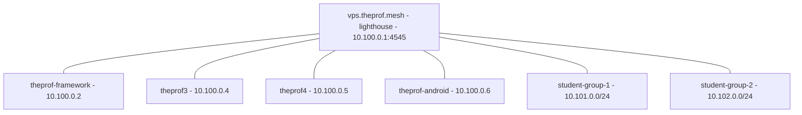

# User stories & guiding examples

These two stories are the **guiding examples** for nebula-manager's workflow. They
describe the intended end-to-end experience and double as acceptance criteria for
the current tool. Open or not-yet-implemented work is tracked in
[README ▸ Roadmap / TODO](../README.md#-roadmap--todo) rather than annotated
inline here.

> Motivation: on a host where Nebula is **already installed and running**, the
> first thing the tool should do is **discover what is there** and offer to
> generate `nebula-manager.conf` from it — not ask for a config that the user
> doesn't have yet. See *Story 1 / Phase 0*.

## The two config files (don't mix them up)

| File | Purpose | Typical location |
|---|---|---|
| **`nebula-manager.conf`** | the **tool's** config: `[global]` + `[server.NAME]` sections | `~/.config/nebula-manager/nebula-manager.conf` (or `/etc/nebula/nebula-manager.conf`) |
| **Nebula `config.yml`** | **Nebula's** runtime config: `pki`, `lighthouse`, `listen`, `firewall`, `tun` | `/etc/nebula/config.yml` |

The tool *manages* Nebula `config.yml` files, and *is configured by* `nebula-manager.conf`.

---

## Using it from the TUI (the main way)

Start the tool and everything is selectable from the text-graphical menus:

```bash
./nebula-manager        # or: nebula-manager
```

| Menu | Use it for |
|---|---|
| **Manager Setup** | shows the detected state, then Import/Update / **Import client bundle** / Create / Browse / Edit / Delete config, Manage instances, Certificate Workspace |
| **Instances** | List / Add / Enable-Disable / Remove `[server.*]`, start/stop the service |
| **Certificates** | List / Create CA / Sign / View / Expiry / **Bundle-export client zip** (pick from a list) / Revoke / Switch workspace |
| **Fleet** | **croc mass deployment** (one code per student) / **SSH push** of a config or firewall / SSH reachability probe |
| **Instance Settings** | Validate / Edit Nebula `config.yml` / Firewall / Name resolution |
| **Connectivity** | ping all cert IPs (+ optional `iperf3`) |
| **Diagnostics** | TUN ip, UDP socket, cert expiry |
| **Benchmarks** | `iperf3` server / client |
| **Updates & Install** | update / auto-update scheduler / install / remove |

With no config yet, the tool opens **Manager Setup** for you, showing what it detected
on this host (Nebula installed? a config already present? cert workspace?) before
offering to import, create or browse for one. The command lines shown in the
phases below are the **expert/automation** equivalents of the same menus.

Navigating the plain menus: **Enter** takes the default (bold **Back**/**Exit**),
`b`/`back`/`..` goes back, `m` jumps to the main menu, and `/firewall` (or any
keyword) searches all menus. `?` shows the keys. Top-level entries carry a short
reminder, e.g. *Certificates (CA, nodes, groups)* — **nodes** are mesh members,
**instances** are local Nebula services.

---

## Story 1 — Theprof, the networking teacher

**Situation.** Theprof teaches a Nebula class. He already runs Nebula by hand:

- a **lighthouse** on a VPS: `vps.theprof.mesh` = `10.100.0.1`, reachable at
  `vps.theprof.demo:4545`;
- his laptop `theprof-framework.theprof.mesh` = `10.100.0.2` (a **client**);
- an existing **CA** with certs in `~/keys/nebula` (CA name `TheprofMeshCA`);
- Nebula runs as a **systemd service** (as the `nobody` user), so
  `/etc/nebula/config.yml` is root/service-owned;
- `listen.port: 0` (the OS assigns the UDP port, e.g. `54143`).

He does **not** use nebula-manager yet. He wants to: (a) import this setup,
(b) add two more home machines **and his Android phone**, (c) hand out
per-student profiles.



### Phase 0 — Import the existing setup

**TUI:** *Manager Setup ▸ Import / update from this host*.

Today he would have to create a config by hand. The **intended** experience is a
single discovery pass:

```bash
$ nebula-manager import
Detected a running Nebula installation:
  service:      nebula.service (active)
  nebula:       /usr/bin/nebula (v1.11.2)
  config:       /etc/nebula/config.yml   (service-owned; readable with sudo)
  certs:        /home/theprof/keys/nebula   (CA: TheprofMeshCA, 3 certs)
  tun:          nebula1 (10.100.0.2/24, up)
  lighthouse:   10.100.0.1 -> vps.theprof.demo:4545
  this host:    client (am_lighthouse: false)

Proposed nebula-manager.conf -> ~/.config/nebula-manager/nebula-manager.conf

  [global]
  bin_path=/usr/bin
  cert_dir=/home/theprof/keys/nebula
  default_port=4545

  [server.theprof-framework]
  dir=/etc/nebula
  service=nebula.service
  enabled=true

Write this file? [Y/n]
```

What the importer detects:

- **service(s):** `systemctl list-units/list-unit-files 'nebula*'` → unit name + `FragmentPath`, and the `-config` path from the unit's `ExecStart` (falls back to `/etc/nebula/config.yml`). If `systemctl` cannot reach the bus (containers, restricted shells) it **scans the unit files on disk** (`/etc/systemd/system`, `/run/systemd/system`, `/usr/lib/systemd/system`, `…/systemd/user`) instead.
- **binaries:** `command -v nebula` → proposes `bin_path`.
- **config keys:** `tun.dev`, `listen.port`, `lighthouse.am_lighthouse`, the first `static_host_map` peer, and `pki.ca` (whose directory becomes `cert_dir`).
- **certs:** the `pki` directory, else any detected store (`$NEBULA_KEYS_DIR`, `~/keys/nebula`, `$NEBULA_DIR/certs`, the default); counts `*.crt`.
- **port:** `listen.port`, or auto-detection when it is `0`/unset (same logic as `diag`).
- **read-only:** a privileged config is read only via a readable copy that **asks first and shows the reason + command** before any sudo prompt.

Flags: `--dry-run` (print only), `--yes` (write non-interactively), `--force`
(overwrite), `--from CONFIG` (use a specific Nebula config for discovery),
`--config OUT` (output path). It refuses to write without confirmation on a
non-tty unless `--yes` is given. Re-running it over an existing config keeps a
timestamped backup (`*.bak.YYYYmmdd-HHMMSS`) and updates in place. If nothing is
detected it falls back to:

```bash
nebula-manager config init          # write ~/.config/nebula-manager/nebula-manager.conf
nebula-manager config edit          # replace [server.nebula-example1] with your real server(s)
```

### Phase 1 — Register the existing members

**TUI:** *Instances ▸ Add Instance* (list/enable/disable/remove in the same menu).

```bash
$ nebula-manager server add theprof-framework --dir /etc/nebula --service nebula.service
$ nebula-manager server add vps --role lighthouse --dir /etc/nebula --host vps.theprof.demo:4545
$ nebula-manager cert list --cert-dir ~/keys/nebula
name,type,ips,groups,subnets,from,to
TheprofMeshCA,CA,N/A,None,None,260929,360926
theprof-framework.theprof.mesh,Cert,10.100.0.2/24,laptops,None,260929,360926
vps.theprof.mesh,Cert,10.100.0.1/24,lighthouse:servers,None,260929,360926
```

Other subcommands: `server list` (table of `[server.*]` entries), `server remove NAME`,
`server enable|disable NAME`. `role`/`host` are stored as informational metadata;
the functional keys are `dir`, `service`, `enabled`.

### Phase 2 — Add home machines theprof3 and theprof4

**TUI:** *Instances ▸ Add Instance*, *Certificates ▸ Generate Client Certificate*,
*Certificates ▸ Bundle Client Zip*.

Sign certs unprivileged in the existing workspace. In the TUI the name and IP
are **pre-filled from the existing certs** (domain suffix `.theprof.mesh`, next
free address `10.100.0.4/24`) — just press Enter to accept:

```
[?] Enter the certificate name [theprof-framework.theprof.mesh]: theprof3.theprof.mesh
[?] Enter the IP address [10.100.0.4/24]:
[?] Enter the IP address [10.100.0.5/24]:    # next cert, after .4 is used
```

After signing, the tool asks which **firewall the new node's client template**
should carry (a suggested policy pack, this host's firewall, permissive, Nebula
defaults, or decide later). That choice is remembered per certificate and is
pre-selected when the bundle is exported, so theprof3/theprof4 get the home
rules without re-selecting them.

```bash
$ nebula-manager sign --cert-dir ~/keys/nebula \
      --name theprof3.theprof.mesh --ip 10.100.0.4/24 --groups laptops
$ nebula-manager sign --cert-dir ~/keys/nebula \
      --name theprof4.theprof.mesh --ip 10.100.0.5/24 --groups laptops

$ nebula-manager cert bundle theprof3.theprof.mesh --out ./bundles
$ nebula-manager cert bundle theprof4.theprof.mesh --out ./bundles
```

Each bundle (`./bundles/theprof3.theprof.mesh-nebula-bundle.zip`) contains the cert, key,
`ca.crt` and a `config.yml.template`. The template is populated from the running
Nebula config (or from the `[server.*]` entries + certificates): real
`static_host_map`/`lighthouse.hosts`, `punchy`, `listen`, `tun` and the firewall
policy. Anything that cannot be determined is flagged in the file and as a
warning instead of being silently left as a placeholder. He also edits the
**firewall** so home machines can talk to each other without restrictions:

```yaml
firewall:
  inbound:
    - port: any
      proto: any
      group: laptops          # laptops talk to laptops
  outbound:
    - port: any
      proto: any
      host: any
```

On each new machine: install Nebula first, then use the
**self-contained installer** from the bundle (no clone needed):

```bash
# install Nebula with your distro's package manager, e.g. on Ubuntu:
sudo apt install -y nebula
unzip ~/theprof3.theprof.mesh-nebula-bundle.zip -d ~/nb
sudo bash ~/nb/install.sh            # installs cert/key/CA + config, restarts nebula.service
# user-owned test:  bash ~/nb/install.sh --dir ~/nebula --no-start
```

The installer backs up existing files, **shows a diff and asks** if `config.yml`
already exists, validates the config with `nebula -test`, and (re)starts the
service. The classic route still works — clone the manager and import the
bundle from Setup:

```bash
git clone https://github.com/<you>/nebula-manager    # brings ./nebula-manager + ./lib
cd nebula-manager
./nebula-manager            # Setup -> Import client bundle -> theprof3...zip
```

The import extracts safely, validates `ca.crt` + the client cert/key, installs
them and the populated `config.yml` into `/etc/nebula` (elevating only for the
writes, with backups), creates `nebula-manager.conf`, and reloads straight into
the main menu. Then verify (the installer route already restarted the service):

```bash
systemctl status nebula            # installer route
ip -brief addr show nebula1         # TUN address from the config
# with nebula-manager (either route):
./nebula-manager            # Instances -> Service: Start / Stop
./nebula-manager diag       # verify TUN ip, UDP socket, cert expiry
```

Headless equivalent:

```bash
./nebula-manager import --bundle ~/theprof3.theprof.mesh-nebula-bundle.zip --yes
```

The import offers to enable and start `nebula.service` when it is installed but
not running. To make names resolve, enable DNS **on the lighthouse** once:
**Instance Settings ▸ Name resolution (Nebula DNS)** → serve DNS on the overlay
(`serve_dns`, port 53, firewall UDP/53). Then run the same menu on each client
so `*.theprof.mesh` is routed to the lighthouse via `systemd-resolved`.

<details><summary>Manual alternative (no import wizard)</summary>

```bash
./nebula-manager config init
./nebula-manager config edit                         # add [server.theprof3] with dir/service
unzip ~/theprof3.theprof.mesh-nebula-bundle.zip -d ~/nb
sudo install -d /etc/nebula
sudo cp ~/nb/{ca.crt,theprof3.theprof.mesh.crt,theprof3.theprof.mesh.key} /etc/nebula/
sudo cp ~/nb/config.yml.template /etc/nebula/config.yml
```

</details>

### Phase 2b — Theprof's Android phone (mobile app)

Theprof wants the mesh on his phone while travelling. Mobile clients don't run
`nebula-manager`; the CA host prepares the certificate and the phone joins via
the **Mobile Nebula** app (Defined Networking).

**Which store?** The official app is on **Google Play** (Android) and the
**App Store** (iOS). It is **not on F-Droid** — that request was closed as not
planned (the app has no FOSS license). If he avoids Google Play, the project
publishes **`MobileNebula.apk`** on its GitHub releases page
(`DefinedNet/mobile_nebula`), which can be installed/updated with a tool like
Obtainium.

The key stays on the device: the app generates the keypair and exports only the
**public key**; the CA host signs it. Never copy `ca.key` to a phone.

1. Install **Mobile Nebula**, tap **+**, and create a site (e.g. `theprof.mesh`).
2. Open the site's **Certificate** screen and **share/export the public key**
   (e.g. `theprof-android.pub`) to the CA host.
3. On the CA host, sign that public key and emit a QR code for the certificate:

   ```bash
   cd nebula-manager                       # your checkout
   ./nebula-manager sign --cert-dir ~/keys/nebula \
     --in-pub ~/theprof-android.pub \
     --name theprof-android.theprof.mesh \
     --ip 10.100.0.6/24 --groups mobile \
     --qr ~/keys/nebula/theprof-android.png
   ```

   TUI equivalent: *Certificates ▸ Generate Client Certificate* → answer **yes**
   to “Is this certificate for a phone/tablet (Mobile Nebula)?” and give the
   exported public key; it writes no `.key` and defaults the QR to
   `<cert-dir>/<name>.png`.

   (`--qr` encodes the **certificate only** — the phone already holds the
   matching private key.)
4. In the app's **Certificate** screen scan `theprof-android.png` (or paste the
   `.crt` text). In the **CA** screen paste `ca.crt` (or scan a QR made with
   `qrencode -o ca.png < ca.crt`, if `qrencode` is installed).
5. In the app's **Hosts/lighthouse** section add the lighthouse: Nebula IP
   `10.100.0.1`, underlay `vps.theprof.demo:4545` (his lighthouse port),
   **lighthouse: on**.
6. Save, allow the VPN profile, and enable the site. Verify from the laptop:

   ```bash
   ping 10.100.0.6            # the phone's overlay IP
   ```

Notes:

- The cert name follows the same convention (`theprof-android.theprof.mesh`);
   `10.100.0.6/24` is the next free address after `.4`/`.5`.
- Group `mobile` is handy for firewall rules. The current config allows all, so
   nothing else is needed here; restrict/allow `mobile` wherever inbound rules
   are tightened.
- Recent app versions support **Always On** and importing a full `config.yml`;
   the cert + CA + lighthouse flow above is the portable path.
- `nebula-manager sign --in-pub … --qr …` (and the TUI mobile question) handles
   this step; it never writes a private key for a device-generated key.

### Phase 2c — Tidy the accidental `laptops` group

Because the early certificates were all signed with `--groups laptops`, every
home machine (the framework, the ge75 and the new boxes) shares the same group,
while the VPS is in `lighthouse,servers`. theprof wants a clearer name and room
for more roles (`admin`, `mobile`, `students`).

**TUI:** *Certificates ▸ Edit Groups (Batch)…* — a filter, a checkbox list, then
one action. Rename is just one of the actions.

1. filter `group:laptops`; confirm the three matches (the VPS is absent because
   it never carried `laptops`);
2. action **rename** — pick `laptops` from the listed workspace groups (or
   type it), then enter `home`;
3. the preview lists exactly which certificates change and which do not:

   ```text
theprof-framework.theprof.mesh.crt (10.100.0.2/24): [laptops] -> [home]
theprof-ge75.theprof.mesh.crt      (10.100.0.3/24): [laptops] -> [home]
   ```

4. confirm, and each match is re-signed unprivileged. Name, IP, subnets and
expiry are preserved, duplicates are removed, and every original is kept as
`<name>.crt.bak`. The devices keep their existing private keys, so **nothing has
to be re-installed on them** — they only need the refreshed `.crt` (copy it, or
export a fresh bundle). *Not listed* certificates are byte-identical afterwards.

While the selection is still active, *“Apply another action to the same
selection?”* makes it easy to layer roles: **add** `admin` to the framework,
**add** `mobile` to the phone, and so on.

The same flow headlessly (the `group` command):

```bash
$ nebula-manager group list --cert-dir ~/keys/nebula
$ nebula-manager group rename laptops home --cert-dir ~/keys/nebula      # preview + confirm
$ nebula-manager group add admin --select cert:theprof-framework.theprof.mesh --yes
$ nebula-manager group move laptops home --select group:laptops --yes    # add+remove, one re-sign

# conditional cleanup: drop 'laptops' only from machines that are already 'home'
$ nebula-manager group prune laptops --when group:home --yes
```

`group set "home,admin" --select name:theprof-*` replaces the whole list, and
`--dry-run` previews any action without touching a certificate. Batch actions
require an explicit `--select` (only `rename` defaults to `group:<old>`), and
non-interactive runs refuse without `--yes`.

A **single** machine can also just get a different/multiple group set by
re-signing it explicitly (the key stays valid):

```bash
$ nebula-manager sign --cert-dir ~/keys/nebula \
      --name theprof-framework.theprof.mesh --ip 10.100.0.2/24 \
      --groups admin,home
```

or the same through *Certificates ▸ Generate Client Certificate* (answer **y**
to the overwrite prompt).

Finally he tightens the firewall with the new groups:

**Instance Settings ▸ Edit Firewall ▸ Add a group-based rule from a template** →
*Allow all from a group* → pick `home` (the picker shows `home (3 cert(s))`). If
he wants to lock the host down completely, *Restrict inbound to one group* adds
the allow rule **and** sets `inbound_action: drop`. Existing rules get the same
picker under *add/edit*, so there is no free-text group syntax to remember.

Before saving, the editor shows a diff of the `firewall:` section and asks once.
*Show the effective policy* (or `nebula-manager firewall explain`) then verifies
the result, including how many certificates each group rule actually matches and
a warning for any rule group that no certificate carries:

```text
Inbound default:  drop
Inbound rules (1):
  #0  any      any     groups [home] -> 3 cert(s) match
Groups in workspace:
  home                 3 cert(s)
```

```bash
$ nebula-manager firewall groups  --cert-dir ~/keys/nebula
$ nebula-manager firewall explain --nebula-config /etc/nebula/config.yml
```

With that, `home` can talk to `home`, while `students` stay isolated (their
future policy will use the same picker).

> Note: an existing `.crt.bak` is never overwritten, so a second rename keeps
the *original* certificate around for rollback.

Every overwrite is also recorded in `<store>/nebula-manager.log` and preserved
before the change: a datestamped `backups/<timestamp>-<seq>-<reason>/` folder
(with the old certs/keys and `ACTION.txt`) for a plain store, or a
`nebula-manager: pre-change snapshot` commit when the store is a git repo
(private keys are never committed). *Certificates ▸ Store Backup / Git* or
`nebula-manager cert store status|log|backup|git-init` shows and manages this.

### Phase 2d — One firewall policy for all home machines

theprof has tuned the framework's firewall and now wants **the same rules on
every `home` machine**, including the ones already installed. He saves that
firewall as a named **policy pack** and lets nebula-manager render it per host.

**TUI:** *Instance Settings ▸ Edit Firewall ▸ Policy packs ▸ New pack from this
host's firewall* → name `home`, suggested groups `home`.

```bash
$ nebula-manager policy new home --groups home --description "Home machines"
$ nebula-manager policy list
  home             home                3 rule(s)  Home machines
$ nebula-manager policy show home
$ nebula-manager policy validate home
```

A pack is just a user-owned YAML file
(`~/.config/nebula-manager/policies/home.yml`) with a `firewall:` fragment and
the groups it is meant for. Nothing here needs root.

**New machines:** when he bundles a certificate in group `home`, nebula-manager
**suggests** the `home` pack (explicit menu in the TUI; a hint in the CLI). The
chosen pack is embedded instead of the locally detected firewall:

```bash
$ nebula-manager cert bundle theprof-ge75.theprof.mesh --policy home
$ nebula-manager cert bundle theprof-ge75.theprof.mesh --policy none   # opt out
```

The bundle's `config.yml.template` then starts the firewall with
`# Firewall policy pack: home` and the pack's rules.

**Existing machines** (theprof3/.4 are already running): render the pack for
every matching certificate and copy the result over:

```bash
$ nebula-manager policy export --pack home --select group:home --out ./policies/
# ./policies/theprof3.theprof.mesh/firewall.yml
# ./policies/theprof3.theprof.mesh/README.txt   (scp + yq + restart commands)
```

Distribution is explicit: `fleet ssh NODE --policy home` pushes the change with a
diff, backup, validation and restart; `fleet croc` serves the bundles to the class
with one code per node. nebula-manager never touches a remote host unless you run
one of those commands. On the machine itself he can also apply a pack
directly (working copy, diff confirmation, backup when elevation is needed):

```bash
$ nebula-manager policy apply --pack home --nebula-config /etc/nebula/config.yml
```

Student groups later reuse the same mechanism: a `students` pack with
`groups: [students]` and per-group rules, embedded into every student bundle.

### Phase 2e — Hand out the class bundles, one code per student

**TUI:** *Fleet ▸ Share student bundles via croc* (or headless):

```bash
$ nebula-manager fleet croc --select group:students --policy students
Bundles for your fleet (/home/theprof/fleet-bundles-20261025-101500):
Node                           croc code                      Bundle
alice.theprof.mesh             alice-theprof-mesh-3f9a1c2b    alice.theprof.mesh-nebula-bundle.zip
bob.theprof.mesh               bob-theprof-mesh-7c2e44d1      bob.theprof.mesh-nebula-bundle.zip
...
Students run:
  croc alice-theprof-mesh-3f9a1c2b    # alice.theprof.mesh
  croc bob-theprof-mesh-7c2e44d1      # bob.theprof.mesh
```

Each selected certificate gets a **self-contained bundle** (cert/key/CA, config,
`install.sh`, `install.ps1`, `README.txt`) and its **own croc process**, so there
is no shared archive and no open port to configure. theprof pastes one line per
student into the class chat; `Ctrl-C` stops the remaining senders. Mobile certs
(no local `.key`) are skipped automatically. Add `--dry-run` to create the
bundles and codes without starting any transfer, or `--timeout 600` to stop
after ten minutes.

For an **already-installed** node he can push a firewall change over SSH instead
of handing out a bundle:

```bash
$ nebula-manager fleet probe node4
# tries node4.theprof.mesh, node4.netbird.cloud, node4.local, node4;
# then the current user, root and 'user' (key auth)
$ nebula-manager fleet ssh node4 --policy home --yes
# fetches the remote config, merges only firewall:, shows a diff, backs it up,
# validates with nebula -test and restarts nebula.service
```

Root logins need no sudo; other users need passwordless sudo. `--dry-run` shows
the exact remote commands, and `--config FILE` pushes a complete config instead of
a policy merge.

---

## Story 2 — The students join

Names: **Alex** (Windows 11), **Bianca** (Ubuntu), **Chen** (macOS), **Dana** (iPhone).
Desktop students receive their **own croc code** (or an HTTP URL). Theprof runs
`fleet croc --select group:students --policy students`; each student gets a line
like `croc alice-theprof-mesh-3f9a1c2b`. Each archive is self-contained —
`install.sh` / `install.ps1` plus a `README.txt` with the exact one-liners — so
students do **not** need to clone nebula-manager. Dana receives her signed cert +
`ca.crt` (and an optional QR) for the mobile app instead.

### Bianca — Ubuntu (Debian and Mint work the same)

Per-distribution details (Fedora/RHEL, Arch/CachyOS, SELinux, firewalls) are in
**[docs/linux-distros.md](linux-distros.md)**.

Bianca only needs Nebula plus `curl`/`unzip` (or `croc`); the bundle's
`install.sh` does the rest. Theprof shares either a croc code or an HTTP URL:

```bash
sudo apt update && sudo apt install -y nebula curl unzip

# croc (recommended in class: no open ports, works behind eduroam/NAT)
tmp=$(mktemp -d) && cd "$tmp" && croc --yes CODE-FROM-THEPROF && unzip -q '*.zip' \
  && sudo bash install.sh

# or HTTP
tmp=$(mktemp -d) && curl -fsSL https://class.example/bundles/bianca-nebula-bundle.zip \
  -o "$tmp/b.zip" && unzip -q "$tmp/b.zip" -d "$tmp" && sudo bash "$tmp/install.sh"
```

The installer backs up existing files, validates `config.yml` with `nebula -test`,
and starts/restarts `nebula.service`. If `config.yml` already exists it shows a
diff and asks before touching it. Verify:

```bash
systemctl status nebula
ip -brief addr show nebula1        # confirm 10.101.0.x/24
```

**Optional — the classic manager route.** Clone the repo and import the bundle
(the extra tooling is only needed for the UI/editor and diagnostics):

```bash
sudo apt install -y gawk findutils grep jq sed systemd tar wget coreutils \
                    iperf3 iputils-ping whiptail zip
# yq v4 is only needed by the firewall editor; Ubuntu's archive yq is v3
sudo wget -qO /usr/local/bin/yq https://github.com/mikefarah/yq/releases/latest/download/yq_linux_amd64
sudo chmod +x /usr/local/bin/yq

git clone https://github.com/<you>/nebula-manager
cd nebula-manager
./nebula-manager          # Manager Setup -> Import client bundle -> bianca-nebula-bundle.zip
./nebula-manager diag     # TUN ip, UDP socket, cert expiry
# headless: ./nebula-manager import --bundle ~/bianca-nebula-bundle.zip --yes
```

> **Fedora:** `sudo dnf install -y nebula ... yq ...` (`yq` is v4 there).
> **Arch/CachyOS:** `sudo pacman -S nebula go-yq libnewt ...`.
> The bundle-installer path needs only `nebula` + `curl`/`unzip` (or `croc`).

### Chen — macOS (bundle installer; brew/launchd)

`nebula-manager`'s own service layer is systemd-oriented, but the **bundle
installer** handles macOS: it restarts Nebula via `brew services` when present,
otherwise it looks for a `*nebula*.plist` launchd label and kickstarts it.

```bash
brew install nebula
unzip ~/chen-nebula-bundle.zip -d ~/nb
sudo bash ~/nb/install.sh
# no service found? the script prints the launchctl command to run
#   or use: bash ~/nb/install.sh --dir ~/nebula --no-start
```

The installer backs up existing files and shows a diff before overwriting an
existing `config.yml`. Verification: `brew services list` or
`launchctl print system/<label>`, and `ifconfig nebula0`/`nebula1` for the TUN
address.

You can still clone nebula-manager for diagnostics (`./nebula-manager diag`),
but it is not required for the install.

### Dana — iPhone (App Store mobile app)

Dana joins from iOS. There is no bash/`nebula-manager` on the phone (and no
sideloading), so Theprof prepares her credentials and she imports them into
**Mobile Nebula** from the App Store (free, iOS 15+). The App Store is the only
supported install path.

1. Dana installs **Mobile Nebula**, taps **+**, and creates a site
   (`student-group-1`).
2. In the site's **Certificate** screen she shares her device **public key**
   (`dana-iphone.pub`) with Theprof (AirDrop / Files / Mail).
3. Theprof signs it on the CA host (the private key never leaves her phone):

   ```bash
   ./nebula-manager sign --cert-dir ~/keys/nebula \
     --in-pub ~/dana-iphone.pub \
     --name dana-iphone.student-group-1.theprof.mesh \
     --ip 10.101.0.10/24 --groups students \
     --qr ~/keys/nebula/dana-iphone.png
   ```

4. He sends back `dana-iphone.png` (or the `.crt`) **and** `ca.crt`. She scans
   the cert in the **Certificate** screen, pastes `ca.crt` in the **CA** screen,
   and adds the lighthouse (`10.100.0.1` → `vps.theprof.demo:4545`).
5. Save, allow the VPN configuration, and enable the site. Verify from another
   group member: `ping 10.101.0.10`.

Notes:

- The bundle `.zip` is for the desktop Nebula binary; mobile students get the
   cert + CA (+ optional QR), not the zip.
- `10.101.0.10/24` is a free address in group 1's /24 (pick any unused one).
- Android works the same way (see Story 1, Phase 2b); the mobile app is **not**
   on F-Droid.

### Alex — Windows (native PowerShell installer)

Install Nebula for Windows first (release zip/MSI; `nebula.exe` must be in
`PATH` or `C:\Program Files\Nebula\`), then run the bundle's PowerShell installer
from an **elevated** prompt:

```powershell
powershell -ExecutionPolicy Bypass -File .\install.ps1
# other directory:
powershell -ExecutionPolicy Bypass -File .\install.ps1 -Dir C:\ProgramData\nebula
# automation: -Yes ; files only: -NoStart
```

Or as a one-liner (HTTP example; `croc` works the same way):

```powershell
$d=Join-Path $env:TEMP 'nebula-bundle'; $z=Join-Path $env:TEMP 'nb.zip';
Invoke-WebRequest 'https://class.example/bundles/alex-nebula-bundle.zip' -OutFile $z;
Expand-Archive $z $d -Force;
powershell -ExecutionPolicy Bypass -File (Join-Path $d 'install.ps1')
```

The installer:

- backs up existing files and **shows a diff + asks** before replacing an
  existing `config.yml` (`-Yes` skips the question);
- restricts the private key to `SYSTEM` + `Administrators`;
- copies cert/key/CA/config (rewriting `/etc/nebula` to `-Dir`);
- validates with `nebula.exe -test -config`;
- installs the `Nebula` service (`nebula.exe -service install -config …`) if
  needed and starts/restarts it (`-NoStart` skips this).

- **Option B (fallback):** WSL2 — follow Bianca's Ubuntu steps inside WSL
  (Nebula's TUN still binds to the host via WSL networking).
- Cloning nebula-manager is **not** required for a client install; the classic
  route still works if you want the TUI/diagnostics.

---

## Capability map

| Capability |
|---|
| Create CA, sign certs, list/inspect/expiry, remove |
| Mobile certs (`--in-pub`, `--qr`) |
| **Batch group editing** (add/remove/move/set/rename/prune with a selector) |
| **Firewall group picker + rule templates + `firewall explain`** (this host) |
| **Policy packs** (create, embed in bundles, apply here, export per host) |
| **Store history** (action log, datestamped backups, optional git snapshots) |
| Unprivileged cert workspace (`--cert-dir` / `NEBULA_KEYS_DIR` / auto-detect) |
| Self-contained client bundles (cert/key/CA, config, `install.sh`, `install.ps1`, README) |
| Tool config resolution + `config init/refresh/edit` (offline template) |
| Diagnostics (TUN ip, UDP socket auto-detect, cert expiry) and iperf3 |
| **`import`** (discover a running Nebula) and **`import --bundle --start`** (install + service) |
| **`instance add/list/remove/enable/disable`** (`server` alias) |
| **Fleet croc** mass deployment (one code per node) |
| **Fleet SSH** probe, config/firewall push, validation and restart |
| Windows-native bundle installer (`install.ps1`) |
| Update checks and auto-update |

These stories double as acceptance criteria for the workflows above. Open items
(profiles, macOS launchd in the TUI, pod/container support, and real
Windows/Android/iOS confirmation) are tracked in
[README ▸ Roadmap / TODO](../README.md#-roadmap--todo).
